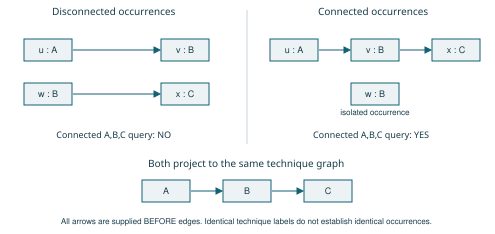

# CTI Evidence Lab

**Occurrence identity and temporal information loss in cyber threat intelligence graphs.**

CTI Evidence Lab studies how replacing individual attack occurrences with ATT&CK technique nodes changes temporal relations and sequence-query answers. It combines controlled graph experiments, source-bound exploratory cases, and evidence-validation software.

## Sequence investigator

Ask whether three techniques form one connected occurrence sequence. Inspect the supporting actions, locate incompatible joins in a technique graph, compare interpretation profiles and export a recomputable answer record.

```sh
python scripts/build_investigation.py
```

Open `outputs/investigation/index.html` in a browser. The artifact runs offline and includes both recorded intrusion cases. Optional local source loading reveals passages only after a snapshot-hash match. [Workflow, comparison with prior work and evaluation](research/INVESTIGATION_WORKFLOW_v0.1.md) define what the answers establish and what remains untested.

## Research question

Can a technique-level path establish a connected sequence of source-supported attack occurrences?

Two occurrence graphs can have identical technique projections while supporting different sequence answers. The example below has no projected cycle: the ambiguity comes from merging distinct occurrences with the same technique label.



## Findings and evidence

- **Edge loss:** a relation between two occurrences mapped exclusively to the same technique disappears when diagonal technique pairs are excluded.
- **Sequence ambiguity:** retaining self-loops does not recover occurrence identity. Endpoint-compatible joins and diagonal retention address different query failures.
- **Source sensitivity:** the exploratory RDP case separates attempted actions, confirmed successes and withheld mappings, producing different eligible graphs.

The controlled experiments enumerate 5,184 singleton-mapping graphs and 4,096 set-valued-mapping graphs for connected-sequence queries. Their rates describe the constructed inputs, not incident prevalence or extraction accuracy. The original five-report AnnoCTR review, two separately fixed five-report extensions and two external intrusion cases remain exploratory; independent annotation agreement and population-level conclusions are not established.

## Research artifacts

| Artifact | Contents |
|---|---|
| [Five-publisher evaluation](research/experiments/external_sequence_evaluation_v0.1/README.md) | Frozen selection, conditional procedures and no-advantage results |
| [Research report](research/FEASIBILITY_REPORT_v0.1.md) | Question, source feasibility, representation experiments and limitations |
| [Query-fidelity study](research/QUERY_FIDELITY_STUDY_v0.1.md) | Counterexample, proof, four-way comparison and full confusion matrices |
| [RDP case study](research/case_studies/dfir_rdp_v0.1/README.md) | Source-bound occurrence interpretation and outcome/mapping sensitivities |
| [RDP sequence extension](research/case_studies/dfir_rdp_sequence_v0.2/README.md) | Four actions from the same intrusion; conditional sequence results and unresolved mapping coverage |
| [Domain-controller sequence](research/case_studies/dfir_html_smuggling_v0.1/README.md) | Second intrusion; successful core query, join error and exact-technique sensitivity |
| [AnnoCTR feasibility review](research/feasibility/exploratory_review_v0.1/README.md) | Five fixed reports, source bindings and unresolved judgments |
| [Fixed source extension](research/feasibility/rank_two_extension_v0.1/README.md) | Five additional reports selected before review; ordering, execution context and coverage |
| [Research index](research/README.md) | Data access, protocols, sampling and provenance records |
| [Study status](docs/PROJECT_STATE.md) | Current evidence and remaining research limitations |

## Reproduction

Python 3.11+ and Git are required. From a clean checkout:

```sh
python scripts/reproduce_study.py
```

This runs the test suites, regenerates experiments and case sensitivities, and produces a versioned artifact archive with file hashes. Source rechecks require local source copies; PDF rendering optionally requires ReportLab. Commands, data-access details and artifact formats are documented in [Reproducibility](docs/REPRODUCIBILITY.md).

[Continuous integration](https://github.com/sanketnichit/cti-evidence-lab/actions/workflows/projection-tests.yml) verifies the software, schema checksums and blank annotation bundles. These checks do not validate the meaning of source interpretations.

## Repository structure

```text
research/   studies, results, source records, protocols and schema reconstruction
src/        occurrence queries and projection/validation utilities
examples/   controlled experiments and historical illustrations
scripts/    source audits, case analysis and reproduction
tests/     regression and finite-oracle checks
docs/       methodology, architecture, status and reproducibility
```

## Citation and license

Sanket Nichit (2026). *CTI Evidence Lab*. Citation metadata is available in [CITATION.cff](CITATION.cff) and [CITATION.bib](CITATION.bib).

Original project software and documentation are [MIT licensed](LICENSE). Source reports retain their own rights. Adapted AnnoCTR material retains CC BY-SA 4.0 attribution and terms; raw reports are not distributed in this repository.
