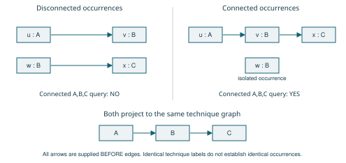

# When technique graphs lose incident sequence evidence

**Sanket Nichit · CTI Evidence Lab · 25 November 2026**

Research manuscript draft

## Abstract

Cyber threat intelligence reports can describe the same ATT&CK technique at several points in an intrusion. A graph with one node per technique can then connect two edges that refer to different actions. We study a query that asks whether three distinct actions form a path through two explicitly supported ordering relations. We give a counterexample showing that the technique projection, even with edge multiplicities, cannot in general determine the answer. A controlled comparison varies whether the projection retains same-technique edges and whether joins require matching action identities. Across 5,184 synthetic graphs with single-label mappings, ordinary traversal produced unsupported answers, and excluding same-technique edges also lost supported answers. Retaining both endpoint identities and same-technique edges preserved all reference answers. In source interpretations from two publishers, the comparison found ordinary agreement, unsupported joins, and projected answers whose status depended on unresolved mappings. The evidence supports a conditional result about the representation. The frequency of these failures across incident reports and their effect on analyst decisions remain open questions.

## 1. Research question

Can a path in a technique graph establish a connected sequence of reported actions? A technique label describes a class of behavior. Two actions in one incident may share that label while involving different times, endpoints or purposes. When the projection merges them, a path in the projected graph can survive even when the corresponding actions never connect in the retained occurrence graph.

This study gives a counterexample, separates two sources of query error in a controlled experiment, and tests the resulting distinctions under several source interpretations. The reference throughout is the supplied occurrence graph. Evidence for the meaning of its actions and edges comes from the incident reports and the recorded interpretation decisions.

## 2. Related work

ChronoCTI predicts temporal relations over distinct technique pairs in a report. Its candidate-pair definition motivates the distinct-pair baseline. We hold the occurrence graph fixed to isolate what the pair representation retains. A comparison of learned predictions would require common inputs and independent reference annotations. See [Rahman et al., 2025](https://link.springer.com/article/10.1007/s10115-025-02491-6).

Attack Flow represents individual actions with optional technique identifiers and execution times. Its links can express potential effects and conditions. AttacKG+ represents temporal progression through behavior graphs, technique mappings and state summaries. AttackSeqBench evaluates reasoning about reconstructed sequences at tactic, technique and procedure levels. These works establish action-level graph and sequence reasoning approaches. Our evaluation targets explicit two-edge witnesses and the loss of shared endpoints under projection. See the [Attack Flow specification](https://center-for-threat-informed-defense.github.io/attack-flow/language/), [AttacKG+](https://doi.org/10.1016/j.cose.2024.104220) and [AttackSeqBench v3](https://arxiv.org/html/2503.03170v3).

AnnoCTR supplies cybersecurity concepts and temporal expressions for CTI text. MATRES provides a precedent for defining temporal relations over event anchors. Work on explainable certain answers provides a broader basis for querying incomplete information. Our mapping rule is deliberately limited to fixed actions, fixed edges and unknown labels. See [AnnoCTR](https://aclanthology.org/2024.lrec-main.103/), [MATRES](https://aclanthology.org/P18-1122/) and [Amendola and Libkin, 2018](https://ijcai.org/proceedings/2018/233). The [related-work assessment](RELATED_WORK_MATRIX.md#closest-system-comparison) gives the detailed comparisons and access limitations.

## 3. Method

### Occurrence graphs and query semantics

An occurrence is a distinct reported action in the incident interpretation. Each directed edge is a supplied BEFORE relation. It requires an explicit source link, such as a stated relative time or wording that orders the two actions. The graph uses neither transitive closure nor immediate adjacency. Narrative position, general capability statements and hypothetical dependencies are insufficient by themselves.

For query (A, B, C), a confirmed witness consists of distinct occurrences u, v and w, with edges u → v and v → w and with A, B and C in their respective known mapping sets. A query is supported if it has such a witness. Without a confirmed witness, it is unresolved if a retained path matches after assigning the required labels to unknown mappings. The open rule permits any query label at an unknown occurrence. Otherwise the query is unsupported in the retained graph. A declared candidate bound can limit possible labels while leaving the mapping unresolved.

### Controlled comparison

Each occurrence edge contributes the cross-product of its two known technique sets. The four representations vary two choices. The first is whether to retain a pair whose labels are equal. The second is whether traversal joins by technique alone or also requires the same middle occurrence identity. The source oracle enumerates distinct occurrence triples directly. An unmapped occurrence supplies no projected technique pair. In cases with unknown mappings, a projected return for an unresolved query is counted in its own category.

### Source selection and evidence

Three fixed five-report groups from a 120-report AnnoCTR frame assessed whether existing reports support this kind of incident annotation. The groups used the recorded donor ranking. They remain separate from the incident cases, and conditional malware procedures are reported separately from observed incident sequences. Records and access instructions are in the [AnnoCTR feasibility review](feasibility/exploratory_review_v0.1/README.md), [rank-two extension](feasibility/rank_two_extension_v0.1/README.md) and [rank-three evaluation](experiments/external_sequence_evaluation_v0.1/README.md).

The incident evidence comprises a purposive DFIR RDP case followed by three next-report selections from saved publisher metadata, plus two CISA advisories fixed in a purposive search frame. Selection rules and disclosure of prior snippet exposure are in each case record. The holdout uses Case Summary prose. The CISA extension uses the incident narrative sections of the advisories. We retain unassessed reports and document exclusions, attempted actions and ambiguous mappings. Parent labels use Enterprise ATT&CK v12.1. Source records carry paragraph or page offsets, hashes and a rationale for each recorded action and edge. Hash checks establish locator integrity. Independent review of the interpretations is pending.

## 4. Representation results

Consider u:A → v:B and w:B → x:C with v and w distinct. Compare them with u:A → v:B → x:C. Both graphs yield the same technique pairs A → B and B → C with the same counts. Only the second graph supports the connected sequence. Neither technique graph contains a cycle. Any rule that uses only these identical projections must give the same answer for both inputs.



There are two separate failure mechanisms. Removing diagonal pairs can erase a required edge image. With loops retained, technique-only traversal can still combine different occurrences or reuse a single edge as two hops. When both endpoint identities are retained, each reported answer corresponds to a source witness because the join checks the middle identity. Every source witness contributes both edge images when diagonals are retained. The [formal argument and full counts](QUERY_FIDELITY_STUDY_v0.1.md) include the set-valued mapping construction.

The singleton experiment enumerates every forward-edge subset on four ordered vertices with three possible labels at each vertex. Across 5,184 graphs and 139,968 graph-query instances, the four representations give the following counts.

| Representation | Unsupported returns | Missed supported queries |
|---|---:|---:|
| Distinct technique pairs | 1,416 | 2,538 |
| Loop-preserving technique pairs | 7,527 | 0 |
| Distinct pairs with endpoint joins | 0 | 2,538 |
| Loop-preserving pairs with endpoint joins | 0 | 0 |

The 4,096 set-valued mapping graphs reproduce the same distinction for queries with known witnesses. A [separate edge and cycle check](experiments/representation_controls_v0.1/README.md) shows that a projected cycle can come from multiple occurrences collapsing or from multiple labels on a single edge.

## 5. Incident and corpus findings

| Source group | Comparison outcome |
|---|---|
| [RDP attempts](case_studies/dfir_rdp_sequence_v0.2/README.md) | The full proposed-mapping profile has three supported queries. Distinct pairs miss one, while ordinary loop traversal returns two unsupported queries. A narrower ordering profile yields agreement. |
| [Domain-controller sequence](case_studies/dfir_html_smuggling_v0.1/README.md) | All four views preserve the core chain. On the extended proposed mapping, both ordinary views add an unsupported answer by joining two distinct scripts. The error also appears at exact technique level. |
| [Chronological DFIR holdout](experiments/incident_holdout_v0.1/README.md) | Hive yields one fully mapped query and agreement. In NetSupport, each ordinary view returns seven supported queries, two unresolved queries and three unsupported queries. Endpoint joins retain the seven supported answers. |
| [CISA publisher extension](experiments/cisa_incident_extension_v0.1/README.md) | One advisory is unassessed for the three-action query. In the other, all views preserve three supported answers. The ordinary loop view also returns three unresolved answers. |
| [AnnoCTR rank-three procedures](experiments/external_sequence_evaluation_v0.1/README.md) | No qualifying incident chain established in the five reports. Four conditional procedure graphs give two supported and four unresolved queries among 70 constructed questions. All views agree on the decidable queries. |

These results show agreement and disagreement under specific graph interpretations. In the NetSupport graph, the two source edges behind one unsupported answer involve different script actions from separate episodes. The mismatch survives either of two separately considered post-review edge omissions. In the CISA graph, a loop answer reuses an edge between two dated access events. A different occurrence path remains possible only if two unmapped actions receive the queried label. That open-rule possibility warrants the unresolved classification. It does not provide a witness for the projected join.

## 6. Sensitivity, runtime and artifact

The [interpretation stress test](experiments/interpretation_sensitivity_v0.1/README.md) applies 203 single or paired changes to the two original incident profiles. Every scenario removes support for at least one baseline query. Single mapping withdrawals move 21 affected query instances to unresolved. Single relation omissions and action exclusions move 35 to unsupported in the retained graph. The scenario count reflects related changes to two graphs. It gives no estimate of annotation error frequency.

In the [input-error experiment](experiments/interpretation_sensitivity_v0.1/README.md#sensitivity-to-incorrect-or-extra-assertions), 40 acyclic edits introduce 66 supported query instances relative to the baseline graphs. The loop-preserving endpoint join returns them because it faithfully answers the edited graph. All three attempted same-label merges in the incident graphs create cycles. An acyclic synthetic merge still creates a spurious witness. These controls show why the formal guarantee depends on correct ordering, mapping and action identity.

The [scaling experiment](experiments/sequence_scaling_v0.1/README.md) uses 16 synthetic chain and hub graphs. At 128 actions, the endpoint encoding occupies about 10 to 27 times the compact JSON bytes of ordinary pairs across the tested workloads. Endpoint answer enumeration takes under 7 ms on that machine. Replacing the investigator's full triple scan with adjacency traversal reduces the paired median for a full diagnostic from 351–364 ms to 0.19–0.47 ms across the four 128-action workloads. The answer records match on every timed workload and on 1,132 additional record comparisons. Incompatible joins can still grow with the product of the matching edge sets. The measurements cover one machine, graphs up to 128 actions and the stated encoding.

The [offline investigator](INVESTIGATION_WORKFLOW_v0.1.md) exposes witnesses, source locators and incompatible joins for the two original cases. Chromium checks cover three viewport widths, keyboard traversal, local source matching and export. For human evaluation, the [analyst pilot](ANALYST_PILOT_v0.1.md) compares static technique and occurrence views on the same questions. The [independent review kit](experiments/incident_holdout_v0.1/README.md#independent-source-review) collects new source interpretations before adjudication. Both protocols are ready for data collection.

## 7. Limitations and conclusion

The claims have different levels of support. The counterexample and compatibility argument apply to the specified query on supplied graphs. The incident results depend on choices about action identity, mapping, outcome and relation evidence. Source extracts omit some figures and telemetry. The chronological DFIR extension controls report genre within one publisher. The CISA extension changes publisher and format using a small search-derived sample. These selections cannot estimate population prevalence. Query counts within a graph share the same source evidence and are unsuitable as independent sample sizes.

The open rule is intentionally permissive. It may admit labels that would prove implausible under a richer account of the action. Candidate bounds help identify which assumptions drive a decision, but their completeness needs independent evidence. Software checks cannot establish semantic accuracy or analyst benefit. Independent reviewers should align action identity before scoring mappings and temporal agreement. The existing protocols and completed software runs provide no participant outcomes.

The principal result is a representation guarantee with a practical boundary. Retaining the two endpoint identities and same-technique edges preserves this connected query on a supplied graph. The incident comparisons show concrete cases where the guarantee changes the answer and cases where the simpler view suffices. This supports keeping occurrence evidence when connected sequence verification is part of the task.

## 8. Reproduction

Run from a clean checkout with Python 3.11 or later and Git.

```sh
python scripts/reproduce_study.py
python scripts/evaluate_incident_holdout.py
python scripts/evaluate_cisa_extension.py
```

The main command checks the study, regenerates its results and writes a source-text-free archive with a SHA-256 manifest. Use `--pdf` with ReportLab to render this draft. The two evaluation commands also support rechecking source bytes against saved publisher copies. The CISA page auditor requires the stated version of pypdf. See [reproduction documentation](../docs/REPRODUCIBILITY.md) for corpus and snapshot commands. Recorded timing samples and their rerun commands are in the scaling study.
