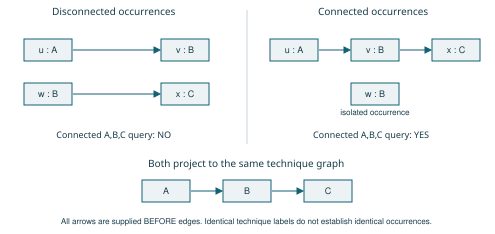

# When a technique path is not an occurrence sequence

**18 November 2026. Controlled representation study; no new corpus labels.**

## Question and why the earlier experiment was insufficient

Counting omitted edges and projected cycles does not establish whether an analyst can answer a connected-sequence question. A graph can retain every projected edge, remain acyclic, and still suggest a sequence that the source occurrence graph does not support. We therefore evaluate a downstream query rather than using software-test counts as evidence of practical value.

The query is: **do there exist three distinct occurrences u, v, w, with supplied BEFORE edges u→v and v→w, whose mappings contain A, B and C respectively?** The same intermediate occurrence v must support both edges. We require two supplied edges; we do not add transitive closure, infer chronology from narrative order, or treat dependency edges as BEFORE. An unsupported answer means unsupported by the supplied graph, not proven absent from a real intrusion.

## A counterexample that does not involve cycles

Consider four occurrences with mappings u:A, v:B, w:B, x:C.

| Source graph | Supplied edges | Connected A,B,C sequence? |
|---|---|---|
| Disconnected | u→v and w→x | No |
| Connected | u→v and v→x; w is isolated | Yes |

Both graphs produce exactly the same technique graph A→B→C. They have the same four occurrence nodes, two source edges, technique assignments, projected pair counts and per-pair multiplicities. Neither technique graph has a cycle. A rule that sees only these summaries must return the same answer for both, so it cannot answer correctly in both cases. A source-edge ID alone does not repair this unless it resolves to the source and target occurrence IDs: two unrelated edge identifiers carry no join semantics.

This is a simple non-identifiability argument, not a claimed new graph theorem. It isolates the information the representation needs to answer this particular question. Adding loops or counting parallel technique edges cannot solve this example.

## Representations and the two independent changes

| Representation | Keep same-technique images? | Require shared occurrence at join? |
|---|---|---|
| Distinct pairs | No | No |
| Loop-inclusive pairs | Yes | No |
| Distinct pairs with endpoint join | No | Yes |
| Loop-inclusive pairs with endpoint join | Yes | Yes |

The first two representations perform ordinary two-hop traversal over technique-pair keys. The endpoint variants attach the original occurrence endpoints to each projected edge image and require the first edge's target ID to equal the second edge's source ID, as well as matching the intermediate technique. The source oracle independently enumerates distinct occurrence triples and checks the two original edges.

**Soundness.** Any endpoint-compatible answer supplies edges (u,v) and (v,w) plus the three required mappings, so it has a witness in the source graph. **Completeness with loops.** Any source witness produces both edge images, including diagonal images, and their endpoints join; therefore the loop-inclusive endpoint variant returns it. These are fidelity guarantees conditional on correct input, not extraction performance. Deleting diagonal images preserves soundness but can remove valid witnesses. For queries whose adjacent labels differ, the deletion removes neither required image.

The remedy is to retain occurrence identity and query it. The endpoint sidecar is another encoding of the occurrence graph for this task; it is not a new event representation or a learned system.

## Finite design

Two separate constructions distinguish occurrence collapse from mapping ambiguity:

1. **Four occurrences, singleton mappings.** Assign one of three techniques to each vertex (3^4 possibilities), then enumerate all subsets of the six forward edges (2^6). This gives 5,184 acyclic source graphs. Repeated mappings are allowed. This construction already contains disconnected middle occurrences; no multi-mapping is needed to cause false answers.
2. **Three occurrences, set-valued mappings.** Assign any of the eight subsets of the same vocabulary to each vertex and enumerate all eight subsets of the three forward edges: 8^3 × 8 = 4,096 graphs. Empty mappings and multi-mappings are included explicitly.

Each graph receives all 27 ordered technique-triple queries. The first construction therefore has 139,968 query instances and the second 110,592. Each graph-query pair has equal weight. These are exhaustive labeled constructions under a fixed topological order, not a random incident sample or a uniform distribution over graph isomorphism classes. The JSON additionally reports the 12 queries with distinct adjacent labels to separate path-joining errors from diagonal deletion.

TP/FP/FN/TN compare each representation's Boolean answer with the source oracle. Precision is TP/(TP+FP), recall is TP/(TP+FN); an empty denominator is undefined. No significance test or confidence interval is appropriate for treating this fully enumerated constructed universe as a sampled CTI population.

## Results and interpretation

For the singleton construction, distinct pairs return 2,064 supported answers, 1,416 unsupported answers and miss 2,538 supported queries. Allowing loops recovers those missed queries but increases unsupported answers to 7,527. Endpoint-compatible joins eliminate unsupported answers; retaining diagonals is also necessary for full recall over the complete query set. Full confusion matrices for both constructions are [generated from the executable benchmark](experiments/query_fidelity_v0.1/README.md).

The loop-inclusive technique graph can even reuse the image of a single A-mapped edge as two loop traversals and answer A,A,A, although its source has only two occurrences. A separate three-occurrence A→A→A chain really supports that query. The four named counterexamples in the JSON expose these distinctions without relying on aggregate scores.

Perfect fidelity for the endpoint variant follows from its construction and the proof above. It is not evidence of better incident detection or better annotation. The value of the comparison is the separation of two failure mechanisms and the specification of what a query implementation must preserve.

Logical storage totals report source edges, distinct pair keys, loop-inclusive pair keys and endpoint-image rows. They are not byte counts or a runtime benchmark. With mapping sets M(u), M(v), one source edge can require |M(u)|×|M(v)| image rows. Keeping the occurrence graph plus mappings avoids materializing all images; database engineering and scale testing remain separate work.

## Relationship to established work

[ChronoCTI](https://link.springer.com/article/10.1007/s10115-025-02491-6), sections 4.5.2 and 4.6, defines a distinct-technique pair universe and technique-node temporal graphs. That makes the abstraction relevant, but this benchmark is not a run or evaluation of its trained model.

[Attack Flow's language specification](https://center-for-threat-informed-defense.github.io/attack-flow/language/) already gives individual actions separate IDs and optional technique IDs. Its effect relationships describe dependencies and outcomes; we do not relabel those as observed temporal relations. Occurrence-aware modeling is therefore established prior art. [AttacKG+](https://doi.org/10.1016/j.cose.2024.104220) also organizes behavior and technique labels across temporal steps. Our controlled comparison does not establish superiority over either system.

Sources above were checked on 18 November 2026. The narrow contribution is an inspectable query-fidelity evaluation and an explicit counterexample to using a technique path as sufficient evidence for a connected occurrence sequence. Novelty beyond this application remains unestablished.

## Limits and the next substantive evidence

The inputs are supplied DAGs with correct IDs, mappings and BEFORE edges by assumption. Incorrect coreference can make an endpoint join wrong about reality even when it is exact on the input graph. Missing mappings can hide entire source paths from the technique-query universe; zero query error therefore does not establish source coverage. We have not evaluated arbitrary path lengths, simultaneous events, uncertainty propagation, extraction, runtime at scale, or real-report frequency.

The five fixed AnnoCTR reports retain their exploratory dispositions. They have not become a temporal gold dataset merely because a synthetic query benchmark passes. A separate [source-bound RDP sequence extension](case_studies/dfir_rdp_sequence_v0.2/README.md) applies these query definitions to four actions from one purposively selected intrusion. Its unresolved cleanup mapping prevents an unconditional error assessment; an explicitly assumed mapping yields both failure cases and a successful local-edge comparison. This same-case sensitivity is not an independent replication. Broader source-supported graphs and interpretation-error analysis remain necessary, retaining the original sample rather than replacing low-yield reports.

Reproduce: `python -m examples.query_fidelity_benchmark --output-dir research/experiments/query_fidelity_v0.1`. Regression tests cover the non-identifiable graph pair, loop reuse, diagonal loss, missing mappings, rejected cyclic/unknown inputs, renaming invariance, agreement with existing projection pair counts, and exact regeneration of both finite constructions.

The subsequent [fixed rank-two source review](feasibility/rank_two_extension_v0.1/README.md) retains five additional reports selected before their review. It distinguishes explicit campaign ordering and observed sample execution from resolved victim-side occurrence sequences. No qualifying primary sequence is established in that pass, so no query-error score is added for those reports.

A [second external intrusion](case_studies/dfir_html_smuggling_v0.1/README.md), selected from the publisher's chronological metadata before content review, supplies an ordinary successful three-action core query. Its six-action extension isolates a join error without diagonal loss, also present with exact technique IDs. The extension depends on a purpose-sensitive archive mapping; withholding that mapping leaves half its source paths fully mapped and suppresses error scoring. These are two source interpretations from one publisher, not independent annotation validation or a prevalence sample.
