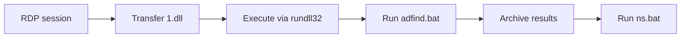

# Domain-controller sequence: transfer, execution and discovery

**Second external intrusion case; exploratory source interpretation.** The [selection record](selection.json) was [committed before content review](https://github.com/sanketnichit/cti-evidence-lab/commit/0077af886adfed5de7ceee15ef7510ef31a3f917). It selects the next report returned by the publisher's chronological metadata query after the original case. This does not establish a complete historical census or an independent annotation replication.

## Source and occurrence boundaries

The [publisher report](https://thedfirreport.com/2023/08/28/html-smuggling-leads-to-domain-wide-ransomware/) describes a November 2022 intrusion. The core interpretation distinguishes initiation of an RDP session to a domain controller, transfer of `1.dll` from the beachhead, and execution through `rundll32` on the destination. These are distinct actions in a shared incident context.

The extended interpretation adds two named batch-file invocations separated by archiving. Each invocation is one occurrence; child commands and per-host loop iterations are not expanded. Thirteen paragraph bindings cover these decisions and a separate unresolved copy-redundancy candidate. Images and underlying telemetry have not been independently validated.



All five edges represent explicit source-order interpretations. No transitive closure or immediate adjacency is assumed. The graph is a selected subgraph, not a reconstruction of every intrusion action.

## Results

| Profile | Fully mapped / retained source paths | Ordinary pair graphs | Endpoint-compatible joins |
|---|---:|---|---|
| Core transfer/execution | 1 / 1 | One supported answer; no unsupported or missed answers | Same |
| Extended, parent techniques | 4 / 4 | Four supported answers plus one unsupported answer | Four supported answers only |
| Extended, exact techniques | 4 / 4 | Same failure with exact IDs | Four supported answers only |
| Archive mapping withheld | 2 / 4 | Error assessment withheld | Error assessment withheld |

The core query is `(T1021,T1570,T1218)`. It is an ordinary successful case for all four representations. In the extended interpretation, the two distinct batch invocations share T1059. Ordinary technique traversal additionally returns `(T1560,T1059,T1560)`, joining the final script invocation to an archive that preceded it. The occurrence graph supplies no such path. No diagonal deletion is involved, so loop retention makes no difference here. This isolates a join error from the diagonal-loss mechanism in the earlier case.

## Mapping sensitivity

All mappings are proposed source interpretations checked against [pinned ATT&CK v12.1 objects](case.json). The Windows Command Shell definition explicitly includes batch files; the two script invocations share T1059.003 even before parent mapping. The artifact transfer uses T1570 rather than external ingress, and the DLL invocation uses T1218.011.

The archive mapping requires particular care: 7-Zip compression is reported, but the pinned T1560.001 definition concerns preparation before exfiltration. The report does not establish that purpose for this archive. Withholding its mapping leaves two fully mapped paths out of four. The analyzer reports coverage 0.5 and unassessed errors, not perfect fidelity over the partially hidden graph. The core case does not depend on this mapping.

These are conditional graph-fidelity results, not extraction scores, population rates or proof of absent intrusion activity. Single mappings describe selected action facets rather than exhaustive set-valued annotations. Within-report graph construction is exposed even though report selection preceded content review. The [original case](../dfir_rdp_sequence_v0.2/README.md) and this case remain separate incident records from the same publisher.

## Reproduction

```sh
python scripts/analyze_incident_sequences.py
python scripts/audit_rdp_case.py --case research/case_studies/dfir_html_smuggling_v0.1/case.json --source-html /path/to/saved/source.html
python scripts/reproduce_study.py --incident-source-html /path/to/saved/source.html
```

[Case records](case.json), [query results](results.json) and [source integrity](source_integrity.json) retain the mappings, alternatives and evidence bindings. Raw source text is not redistributed. The article remains subject to its publisher's rights.
