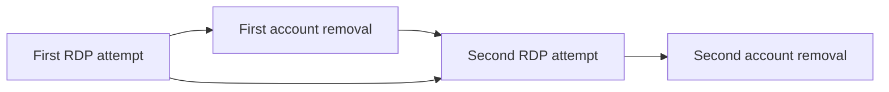

# RDP and account lifecycle: sequence sensitivity

**Exploratory extension of the same purposively selected DFIR intrusion.** This is not another report, an independent replication, or an AnnoCTR sample member. The [two-attempt interpretation](../dfir_rdp_v0.1/README.md) remains available unchanged.

## Source-supported structure

The retained interpretation distinguishes four actions: the first RDP attempt, its associated account removal, the second attempt, and its associated removal. The [publisher's Case Summary](https://thedfirreport.com/2023/06/12/a-truly-graceful-wipe-out/) supports the narrated order. Seven passage bindings cover the retained actions, context and two unresolved candidate chains. `case.json` records exact offsets and hashes; `source_integrity.json` records verification against the saved publisher snapshot.



The full-edge interpretation retains the original direct attempt-order judgment alongside three local ordering links. The diagram does not claim these were the only actions in the intrusion. A query requires two supplied BEFORE relations with a common occurrence, not necessarily immediate action adjacency. No transitive closure is added. The local-edge sensitivity explicitly removes the original attempt-order shortcut; it does not retroactively change v0.1.

## Mapping uncertainty and taxonomy version

Attempted RDP retains the proposed T1021.001→T1021 interpretation. Account removal is explicit, but a T1070.009→T1070 cleanup mapping is unresolved: clearing persistence and retry housekeeping are different possible interpretations of purpose.

The [pinned v12.1 object](https://github.com/mitre/cti/blob/4cbf8cc4bdf2121ee987a23bfe5aac4fe4d2f5b1/enterprise-attack/attack-pattern/attack-pattern--d2c4e5ea-dbdf-4113-805a-b1e2a337fb33.json) describes persistence-artifact removal without the explicit account-deletion example present in the [current definition](https://attack.mitre.org/techniques/T1070/009/). The record pins object version 1.0, its modification date and description hash. Current wording is not substituted for the pinned definition. Taxonomy membership alone cannot validate the source mapping.

Consequently, the conservative profile leaves both account-removal mappings empty. It retains three occurrence paths but maps none completely. Query errors are **not assessed**, rather than recorded as zero.

## Conditional comparison

When the proposed cleanup mapping is explicitly assumed, the full-edge graph supports three technique triples: `(T1021,T1070,T1021)`, `(T1070,T1021,T1070)`, and `(T1021,T1021,T1070)`.

| Representation | Returned queries | Unsupported by interpreted graph | Missed supported queries |
|---|---:|---:|---:|
| Distinct technique pairs | 2 | 0 | 1 |
| Loop-inclusive pairs | 5 | 2 | 0 |
| Distinct pairs with endpoint join | 2 | 0 | 1 |
| Loop-inclusive pairs with endpoint join | 3 | 0 | 0 |

The loop-inclusive graph additionally returns `(T1021,T1021,T1021)` and `(T1070,T1021,T1021)`. Those answers require occurrence combinations absent from the retained four-node graph. This is a statement about that interpretation, not proof that such activity never happened in the intrusion. The endpoint-compatible representation is exact by construction, not independently accurate about the source.

Under the local-edge sensitivity, both retained source paths have different adjacent labels and all four representations answer both correctly. This is an ordinary successful projection case within the same interpretation. The projected two-technique cycle alone therefore does not predict an error for every query.

## Coverage and eligibility

| Profile | Occurrence paths | Fully mapped paths | Query assessment |
|---|---:|---:|---|
| Cleanup unresolved | 3 | 0 | Not assessed |
| Cleanup proposed, full edges | 3 | 3 | Conditional comparison above |
| Cleanup proposed, local edges | 2 | 2 | All four representations retain both answers |
| Reported completed actions only | 0 | 0 | No two-edge opportunity; not assessed |

The completed-action profile retains the two narrated removals but excludes attempts without confirmed success. No direct removal-to-removal relation is added by inference. This changes the eligible question and yields no two-edge path; it does not prove the attempt sequence absent.

## Excluded candidates and limits

The same source's initial payload paragraph groups copying and renaming; a candidate three-node interpretation remains unresolved in atomicity and mapping. Its lateral-movement paragraph spans multiple commands and hosts; individual occurrence selection remains unresolved. These candidates are recorded rather than silently omitted from the search.

The mapping-sensitive result cannot be reported as an unqualified real-world error rate. The four profiles share one source and are not independent samples. No agreement score, population percentage, model comparison or complete incident reconstruction is claimed. Exact timestamps and additional unreported sessions are not inferred.

## Reproduction

```sh
python scripts/analyze_sequence_case.py
python scripts/audit_rdp_case.py --case research/case_studies/dfir_rdp_sequence_v0.2/case.json --source-html /path/to/saved/source.html
```

The first command regenerates all query answers and path coverage from the recorded interpretation. The second verifies the source bindings. The original publisher text and taxonomy downloads remain outside the public repository.
